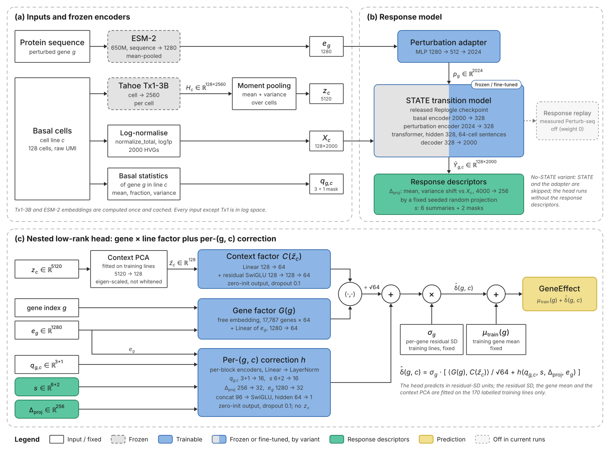
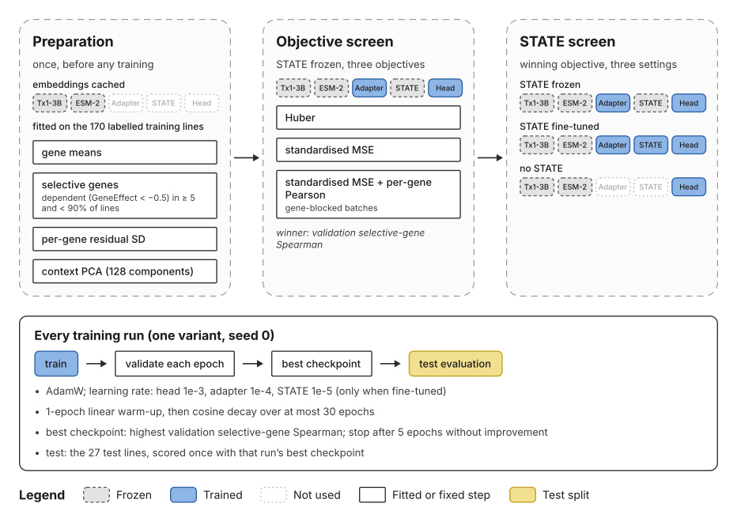
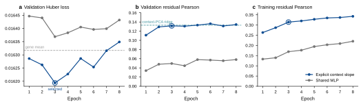
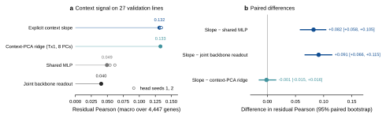
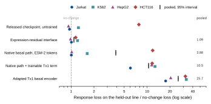

# Experiment Protocol: Held-Out-Cell-Line GeneEffect Prediction

Updated 2026-10-12. This is the protocol for the **implemented** GeneEffect track under
[the research blueprint](01-blueprint.md); it holds the rules (§11), the model, expression space, training,
metrics and results. The design behind the current wiring is the
[expression-space and `all`-run design](specs/2026-10-02-expression-space-and-all-pipeline-design.md),
and operating commands are in the [runbook](../hpc/README.md). One run has completed: seed 0,
trained, tested and baselined ([result](../results/joint_geneeffect_seed0/README.md)). It
predates the expression-space change of §3.4 (STATE was fed raw counts) and its numbers are
not compared like for like with the current pipeline. The best validation model to date is
that backbone frozen under an explicit gene-specific context-slope head (§7, validation
only). Response-pathway diagnostics (§8, [result](../results/p1_response_pathway_diagnostics/README.md))
found that the response pathway learns the cell lines it is adapted on but does not
transfer to a held-out line; §9 specifies the comparison that measures what STATE adds and
the single command that runs the whole pipeline. The 2026-10-03
[revision](specs/2026-10-03-geneeffect-revision-design.md) replaced the joint model's head, objective,
selection rule and STATE treatment (§4–§6, §9.3): §4–§6 state the current rules, while §7 and §8 are
historical records of earlier runs under the earlier head and Huber selection. The
[SL ranking protocol](04-sl-ranking-protocol.md) builds on this backbone; nothing here
is SL evidence. §10 specifies the linear context prior, a CPU control that the joint model is
compared against, §12 the single-cell correction that stacks the joint head on it, §13 the
linear single-cell statistics stack, the first test of whether single-cell resolution adds to
pseudo-bulk, and §14 the noise diagnosis, which measures what limits the default prior before any
denoising model is built. §15 holds the inputs of the PIE-based stage-one model and §16 the model, its
training and its report.

## 1. Objective and prediction unit

For a held-out cell line $c$ and gene $g$, predict the DepMap GeneEffect $y_{g,c}$
from the basal single-cell transcriptome of $c$ and the protein sequence of $g$.
The model predicts the residual over a fixed training gene mean,

$$
\hat y_{g,c}=\mu_{\text{train}}(g)+\hat\delta(g,c),\qquad
\mu_{\text{train}}(g)=\operatorname{mean}_{c\in\mathcal C_{\text{train}}}y_{g,c},
$$

so that the context-blind term is fixed preprocessing and the residual is the
quantity under test. The generalization axis is the cell line, not the gene. No
GeneEffect measurement of $c$ enters the deployable feature path. GeneEffect is a
single-gene dependency: it is not an SL label and estimates no genetic interaction.

The question this protocol answers is whether a perturbation-response model learns
context information that improves held-out-line dependency prediction beyond the
gene mean and simple context predictors. It is stage one of the blueprint's task
([§3.3](01-blueprint.md#33-task-a--cross-line-geneeffect-prediction-stage-one)), with value of its
own and as the backbone of stage two; scored on its own benchmark, it does not substitute for the
SL protocol's pair evaluation.

## 2. Benchmark

The [final split](../configs/benchmarks/cell_line_geneeffect_split.json) is the
sole membership authority ([data card](data/cell-line-geneeffect-split.md)). It is built from the
[226 split](data/cell-line-geneeffect-226.md), which fixes the held-out lines, and the built single-cell
and bulk extras.

| Cohort | Members | Labeled | Role |
| --- | ---: | ---: | --- |
| train | 379 | 377 | supervised fitting: the 226's 171 training lines and the 208 single-cell extras; PC9 and HeLa have no 26Q1 GeneEffect row |
| validation | 27 | 27 | once-per-epoch evaluation, checkpoint selection, early stopping |
| test | 28 | 28 | one-shot final evaluation |

The bulk-only lines (713 labelled, 576 unlabelled) join the training side of the linear prior
through bulk RNA (§10); 12 lines sharing a patient with a held-out line are never read.

The 47 original basal/SL-context union lines are fixed in train except A549, fixed in test
since 2026-10-11 for the SL benchmark (the split was rebuilt in place; results recorded before
that date used the 172/27/27 version with A549 in train). The 179 atlas lines
follow a patient-grouped partition: no patient's lines are split across cohorts, and
GeneEffect values did not determine membership. The 226-line benchmark and the
nine-context SL split never substitute for each other. The planned SL split instead nests in this
one ([blueprint §3.6](01-blueprint.md#36-splits-and-generalization-settings)): its training,
validation and test lines are training, validation and test lines here, so the nine-context split
is no longer the plan.

## 3. Inputs and supervision

### 3.1 Basal cells

Use each line's basal cells as raw UMI counts, never CPM: Tx1 does not read CPM the way
it reads the counts underneath, and the shift survives pooling
([measured](../results/exp13_stage0/README.md)). A fixed random sample of up to 128 basal
cells per line is encoded once by the frozen Tx1-3B foundation model; the same cells,
in the expression space of §3.4, are STATE's basal input.

The training lines are the 226's 171 and the 208 single-cell extras built from public deposits
([card](data/single-cell-atlas-search.md)); an extra's cells are prepared like the 226's and read the
same way. Validation and test lines are the 226's.

### 3.2 Response anchors

Four labeled training lines carry genetic-perturbation response data: K562, HCT116,
Jurkat and HepG2, joined by DepMap ModelID. Use genetic-perturbation responses and
non-targeting controls; a response condition need not carry a GeneEffect observation.
Response supervision is an auxiliary task that fine-tunes STATE: it uses all conditions of
all four anchors and withholds no condition. The 27 GeneEffect validation lines (§2) are the
only validation split, so the response task has no held-out score inside training; its
held-out behaviour is measured by the comparison of §9.

### 3.3 Dependency labels

Use the pinned DepMap 26Q1 GeneEffect release, joined by ModelID. Fit the gene mean, the
variable-gene set, the selective-gene set and per-gene residual SD of §4 and §6 on the 377 labeled
training lines only, and reuse them unchanged in every later evaluation. Test values never enter
preparation or fitting. Missing labels stay missing. Results recorded before 2026-10-12 fit them on
the 226's 169 labelled training lines (3,071 selective genes on the 171/27/28 split, against 4,323 on
the final split), so their metric is not the current one.

### 3.4 Expression space

Every expression quantity except Tx1's input uses one space, the one STATE's released
checkpoint was trained in (arc-state `preprocess_train`): normalise each cell's library to
a target total $T$, take $\log(1+\cdot)$, then slice STATE's 2,000 highly variable genes
(HVGs):

$$
x^{\text{log}}_{ig}=\log\!\Big(1+\frac{T\,x_{ig}}{L_i}\Big),\qquad L_i=\sum_{g'}x_{ig'}\ \text{over all genes of the cell's source matrix.}
$$

- $T$ is the median library size of the non-targeting cells in the Nadig 2025 Jurkat and
  HepG2 response sources, the data STATE's Replogle checkpoint was trained on. It is
  computed once at preparation, recorded in the prepared manifest as `expression_space`,
  and never configured.
- Library size is taken over **all** genes of each source matrix, not over the HVG panel.
  This is a known approximation: gene universes differ slightly between the Nadig,
  Replogle, X-Atlas-Orion and atlas matrices.
- Tx1 keeps raw UMI counts (§3.1). The transform covers STATE's basal bags for every
  prepared line, the response targets and anchor control bags, the basal statistics $q_{g,c}$
  (mean and variance; detected fraction is space-invariant), and the HVG features of the
  context baselines (§6).
- The prepared lines are the split's (the 226 and the built single-cell extras,
  [card](data/single-cell-atlas-search.md)); each line's raw-UMI cells are
  `<paths.basal_raw_umi>/<ModelID>.h5ad`, and a missing file stops preparation. $T$, the gene
  panel and the HVG order are fixed by the 226. Once the manifest exists, a run prepares only
  the lines without `lines/<ModelID>.npz`, in the recorded space, and records the line list in
  the manifest; every other file stays as written. The split path names which lines exist, not
  how one is prepared, so a root recorded under another split path is reused.
- Preparation refuses a source matrix that is already normalised, and loading refuses a
  prepared root without `expression_space`, so a raw-count cache cannot reach STATE.

## 4. Model

*Figure 1. (a) Frozen Tx1-3B encodes the sampled basal cells of line $c$ from raw counts into
cell embeddings that are moment-pooled into a context embedding; frozen ESM-2 encodes gene $g$.
Both are computed once and cached. The same cells in log-normalised HVG expression (§3.4) are
STATE's basal input. (b) A trainable adapter turns the gene embedding into a perturbation
token. The STATE transition model, initialised from a published Replogle checkpoint, reads the
log-normalised basal cells through its own released basal encoder and predicts the line's
post-perturbation expression; it is frozen or fine-tuned by variant (`train.state_mode`), and
the no-STATE variant skips STATE and the adapter. Response replay to measured Perturb-seq is
drawn dashed: it is off in the current runs. Response descriptors summarise how predicted
expression differs from basal expression. (c) The nested low-rank head: a gene factor $G(g)$
(free per-gene embedding plus a linear map of $e_g$) meets a line factor $C(\tilde z_c)$ read
from the training-line context PCA alone, and a per-(g, c) correction $h$ reads the basal
statistics, the response descriptors and $e_g$ but never the context; their sum, scaled by
the fixed per-gene residual SD $\sigma_g$, is $\hat\delta$, and the training gene mean is added
for the GeneEffect prediction. Tx1 feeds only the head; it does not enter
STATE. Arrows carry the tensors passed between modules, shaped for one gene–line condition
(cells × features, no batch dimension); boxes state the width change inside each module. The
adapter emits 2024 values because that is the width of STATE's perturbation vocabulary; STATE
projects it, like the 2000-wide expression input, to its hidden size of 328. Notation: $H_c$,
Tx1 cell embeddings of line $c$; $e_g$ and $p_g$, the gene embedding and the perturbation token;
$X_c$ and $\hat Y_{g,c}$, basal and predicted post-perturbation log expression; $\Delta$ and $s$,
the projected expression shift and scalar response summaries; $q_{g,c}$, basal statistics of $g$
in $c$; $z_c$, the pooled context embedding; $\mu_{\text{train}}(g)$, the training gene mean;
$\hat\delta$, the predicted residual. The training protocol is Figure 2 in §5.*

Figure 1 shows the data flow and the nested head defined below. Tx1 is frozen and supplies cached basal-cell embeddings. STATE and an
ESM2 adapter predict perturbed expression, and the head uses five feature blocks: pooled
expression change $\Delta$ (projected), response dispersion statistics $s$, gene-specific basal
single-cell statistics $q_{g,c}$, gene embedding $e_g$ and the compressed basal context
$\tilde z_c$. $\Delta$, $s$, $q_{g,c}$ and $e_g$ are standardised per dimension with statistics
fitted on training rows, each partial-coverage value paired with an explicit mask bit. The gene
mean $\mu_{\text{train}}$ is fixed preprocessing, not a learned head.

**Context PCA.** The pooled Tx1 context $z_c$ (5120 = mean and variance of the 2560-d cell
embeddings) takes only 170 distinct values in training, one per labelled training line, so its
rank is at most 169 (z-scored, 90% of its variance lies in 86 components). It is therefore
compressed before the head: z-scored per dimension and projected onto its first 128 principal
components (`model.context_components`), all fitted on the labelled training lines only, saved in
the checkpoint and restored at evaluation. The scores are divided by one constant, the SD of the
first component's scores, so the leading component has unit variance and the tail keeps its
smaller scale (eigen-scaled, not whitened); $\tilde z_c$ bypasses the per-dimension standardiser.

**Nested low-rank head.** The head is a rank-$r$ gene $\times$ line product plus a per-(g, c)
correction, rescaled by a fixed per-gene residual scale $\sigma_g$:

$$
\hat\delta(g,c)=\sigma_g\Big[\tfrac{1}{\sqrt r}\,\big\langle G(g),\,C(\tilde z_c)\big\rangle+h\big(q_{g,c},\,s,\,\Delta,\,e_g\big)\Big],\qquad
G(g)=E_g+W e_g,\qquad C(\tilde z)=A\tilde z+\mathrm{SwiGLU}_C(\tilde z).
$$

$E\in\mathbb R^{|\mathcal G|\times r}$ is a free per-gene embedding (normal, SD 0.02) indexed by
the gene's position in the fixed gene order and $W$ a linear map of $e_g$ to $\mathbb R^r$, with
$r=64$ (`model.factor_rank`). $C$ reads only the line context: a linear map $A$ (128 → $r$) plus a
residual branch (SwiGLU 128 → 128, dropout, linear 128 → $r$). With $C=A\tilde z$ the first term is
a reduced-rank regression on the context components, the form of the Tx1 context-PCA ridge. $A$
(weight and bias) and the residual branch's output layer start at zero, as does $h$'s output, so
the head predicts zero before its first update and a stack on the linear context prior (§12)
starts at the prior; the first gradient reaches $A$ through $G$.
$h$ encodes each enabled block separately (linear then LayerNorm: $q$ with its mask → 16, $s$ with
its masks → 16, $\Delta$ → 32, $e_g$ → 32), concatenates them, applies dropout and a SwiGLU layer of
width 64, and ends in a zero-initialised linear map to one value; it never sees the context.
SwiGLU is $(\mathrm{SiLU}(xW_1)\odot xW_2)W_3$. Dropout is 0.1 (`model.dropout`). The layer widths are
fixed in code. There is no per-line lookup anywhere: the only per-line signal is $\tilde z_c$
and, through STATE, the basal cells. This head replaced a trunk MLP over all five blocks plus a
gene $\times$ context product (2 hidden layers of 256, raw 5120-d $z_c$; 4.46M parameters, 1.33M
now), which reached a training-diagnostic selective Spearman of 0.53–0.67 against 0.15 on
validation ([head revision design](specs/2026-10-03-geneeffect-head-revision-design.md)).

$\sigma_g$ is the population SD of the residual $y_{cg}-\mu_{\text{train}}(g)$ over the labeled
training lines, floored at its 10th percentile over genes
(`features.residual_sd_floor_percentile`); a gene with fewer than two labeled training lines takes
the floor. It is fitted on training lines only, saved in the checkpoint, and applied for every
objective, so the head works in units of $\sigma_g$ and $\hat\delta$, the losses in residual
units and every metric use the rescaled prediction.

**STATE settings.** STATE is (a) frozen at the released weights with only the ESM2 adapter
trained, (b) trainable with the adapter (`train.state_mode`: `frozen` or `trainable`), or (c)
absent: with `head_blocks.use_delta_proj` and `use_s` both false the model never calls STATE
or the adapter, and the head is the same network without the $\Delta$ and $s$ blocks.

Predicted and basal expression are compared in one shared gene space, the 2,000 log-space
HVGs of §3.4; basal Tx1 embeddings and predicted expression have different widths and are
never subtracted. Cell distributions are supervised as distributions, without pairing
individual control and perturbed cells. Covariates that are unavailable for a gene or line
are masked, never zero-filled.

## 5. Training and selection

*Figure 2. Training protocol. Preparation fits the gene means, the selective genes and the
per-gene residual SD on training lines once; Tx1-3B and ESM-2 stay frozen throughout. The
objective screen trains the adapter and head with STATE frozen; the STATE screen compares STATE
frozen, STATE fine-tuned and no STATE (head only) under the winning objective. Every run is one
config at seed 0: train, validate each epoch, keep the best checkpoint, then score it once on
test.*

A single joint training loop runs. Every update minimizes one GeneEffect objective
(`train.objective`) on $\hat\delta$ against $r_{cg}=y_{cg}-\mu_{\text{train}}(g)$, with
$e_{cg}=\hat\delta_{cg}-r_{cg}$ and $\sigma_g$ of §4:

| Objective | Loss | Batches |
| --- | --- | --- |
| `huber` | Huber ($\delta=1$) of $e_{cg}$, in residual units | 1024 random rows per rank |
| `standardized_mse` | $\operatorname{mean}\,(e_{cg}/\sigma_g)^2$ | 1024 random rows per rank |
| `pearson_blocks` | $\operatorname{mean}\,(e_{cg}/\sigma_g)^2+\operatorname{mean}_{g\in B}\big(1-\operatorname{Pearson}_c(\hat\delta_{cg}/\sigma_g,\,r_{cg}/\sigma_g)\big)$ | every training line of 6 genes per update (`train.genes_per_block`) |
| `line_ranking` | $\operatorname{mean}\,(e_{cg}/\sigma_g)^2+\operatorname{mean}_{g\in B}\big(-\sum_c p_{cg}\log q_{cg}\big)$, $p_{\cdot g}=\operatorname{softmax}_c(-r_{cg}/\sigma_g)$, $q_{\cdot g}=\operatorname{softmax}_c(-\hat\delta_{cg}/\sigma_g)$ | as `pearson_blocks` |
| `dependency_classification` | $\operatorname{mean}\,(e_{cg}/\sigma_g)^2+\operatorname{BCE}\big(\ell_{cg},\,\mathbf 1[y_{cg}<-0.5]\big)$ over selective rows, $\ell_{cg}=(-0.5-\mu_{\text{train}}(g)-\hat\delta_{cg})/\sigma_g$ | 1024 random rows per rank |

In the blocked objectives $B$ is the set of selective genes (§6) of the batch that have at
least three rows and a non-constant target there; with no such gene the term is zero. The
line-ranking term is the ListNet cross-entropy across a gene's lines (temperature 1 in units of
$\sigma_g$): the target puts most mass on the most dependent lines. The dependency term is the
binary cross-entropy of the measured dependency call (GeneEffect below $-0.5$, §6) against the
logit of the model's own GeneEffect prediction; without a selective row it is zero. Both extra
terms have weight 1. Each
epoch deals a seeded permutation of the genes in blocks round-robin to the ranks and drops the
incomplete tail, so every rank takes the same number of updates. All losses are computed in
FP32.

Response replay is optional. Every fourth update (`response_interval`; 0, 4, 8, …), only when
`train.response_weight`$\,=\lambda>0$, a response batch of 64 conditions balanced across the four
anchors (K562, HepG2, Jurkat, HCT116) and sampled from all of their conditions is added:

$$
L_t=L_{\text{GE}}+\mathbf{1}[t\bmod4=0]\,\lambda\,\big(L_{\text{mean-shift MSE}}+L_{\text{energy distance}}\big).
$$

The base config has $\lambda=0$, so no response batch is drawn and the joint model uses
response data for nothing; a model without STATE cannot replay at all. Earlier runs used
$\lambda=1$ and Huber only.

AdamW (weight decay 0.05, `train.weight_decay`) has up to three parameter groups, each present only when its module
is trained: the head, including the gene embedding and the context tower, at $10^{-3}$; the
ESM2 adapter at $10^{-4}$ when STATE is used; and STATE at $10^{-5}$, only under `trainable`
(a frozen STATE has no gradient and runs without dropout). The learning rate rises linearly
over the first epoch of updates (`warmup_epochs` 1) and then follows a cosine to zero at the
last of at most 30 epochs, stepped per update. Training, cell-collation and projection base
seeds are all 0. Settings are fixed in `configs/geneeffect_joint.yaml`,
`configs/revision/` holds one config per objective with STATE frozen, and `configs/correction/`
the single-cell correction's objective screen (§12). The loop follows the
joint-training design (`docs/specs/2026-09-06-modular-joint-training-design.md`, removed; `git show 1694f5c:<path>`); the
[expression-space design](specs/2026-10-02-expression-space-and-all-pipeline-design.md) set its
response wiring, basal path and validation splits and the
[revision design](specs/2026-10-03-geneeffect-revision-design.md) its head, objectives,
learning rates, schedule and selection.

Validation runs once per completed epoch over the 27 validation lines, the only validation
split, and, when the config names a prior export (§12), once before the first update (epoch
−1), so the prior alone is a candidate for `best.pt`. **Only the maximum validation selective-gene Spearman (§6) selects `best.pt` and
controls early stopping** (patience 5, at most 30 epochs); an undefined selector stops the run
rather than counting as a loss. Each epoch also scores 27 fixed training lines, chosen as
the validation split's size, as a telemetry curve (`train_eval_`): the fit is observed, never
gated. Test restores the checkpoint's preprocessing without refitting or optimizer updates;
the seed-0 test has been observed once and must not become a tuning or checkpoint-selection
surface. Runs before the revision selected on minimum validation GeneEffect Huber loss (§7).

## 6. Evaluation

Evaluate the selected checkpoint with the training-side gene mean, gene sets, residual
scale and normalization restored. Train and validation use their own observed cell-line/gene
pairs and the same train-defined variable-gene and selective-gene sets. Let $y_{cg}$ be the observed GeneEffect, $\mu_g$ the
fitted training gene mean, $r_{cg}=y_{cg}-\mu_g$ the target residual and $\hat r_{cg}$
the predicted residual.

### Selective-gene Spearman ↑ (selection criterion)

A gene is **selective** when it has a dependent tail among the labeled training lines but is
not essential almost everywhere. With dependent meaning $y_{cg}<-0.5$, let $n_g$ be the number
of labeled training lines that depend on $g$ and $m_g$ the number of labeled training lines:

$$
\mathcal G_{\mathrm{sel}}=\{\,g:\ n_g\ge5\ \text{and}\ n_g/m_g<0.9\,\},
\qquad
\rho^{\mathrm{S}}_g=\operatorname{Spearman}_c(r_{cg},\hat r_{cg}),\qquad
\rho^{\mathrm{S}}_{\mathrm{macro}}=\frac{1}{|G_{\mathrm{S}}|}\sum_{g\in G_{\mathrm{S}}}\rho^{\mathrm{S}}_g,
$$

where $G_{\mathrm{S}}\subseteq\mathcal G_{\mathrm{sel}}$ holds the genes with a defined
correlation. The set is fitted on training lines only
(`features.selective_min_lines`, `features.selective_max_fraction`) and stored with the
checkpoint; on the current split it has 3,111 genes, with 1,004 commonly essential genes
excluded ([design](specs/2026-10-03-geneeffect-revision-design.md) §2). The per-gene gene mean is
constant, so $\rho^{\mathrm S}_g$ is the rank correlation of the predicted and observed
GeneEffect of gene $g$ across lines (the centring rules below apply). Undefined correlations are
excluded and counted. This quantity is the selection criterion of §5
(`val_selective_spearman`).

**Why this metric.** Stage two reasons by the blueprint's definition 1
([§3.1](01-blueprint.md#31-synthetic-lethality-two-operational-definitions)), as cohort-based
statistical methods do (DAISY, ISLE and SLIdR): for a gene pair $(a,b)$ it asks whether lines in which $b$
is lost or low depend more strongly on $a$. That compares gene $a$'s dependency across lines,
so what it consumes is the per-gene ranking of lines, concentrated on genes that have a
dependent tail. Selective-gene Spearman measures that ranking directly, whereas the pooled
Huber loss is dominated by high-variance genes and rewards shrinkage
([design](specs/2026-10-03-geneeffect-revision-design.md) §1). It is a GeneEffect diagnostic
chosen for this alignment: no SL computation runs here and it is not SL evidence.

### Selective AUPR lift ↑

For each selective gene with at least one dependent and at least one non-dependent labeled
line in the evaluated split, rank lines by predicted GeneEffect, lowest first, and take the
average precision for the dependent lines minus the prevalence $\pi_g$ of dependent lines:

$$
\mathrm{lift}_g=\mathrm{AP}_g\big(\mathbf 1[y_{cg}<-0.5],\,-\hat y_{cg}\big)-\pi_g,
$$

so a constant prediction scores exactly 0. The macro mean is over the scored genes; scored and
undefined counts are reported. Selective Spearman and AUPR lift are computed identically for
every control below. A paired bootstrap resamples the evaluated lines with replacement, the
same draw for both models, and recomputes each model's macro selective Spearman to give an
interval for the difference between two models (1,000 resamples, seed 0, in the `revision`
summary against the Tx1 context-PCA ridge).

### Residual Pearson ↑

For each variable gene, compute Pearson correlation across cell lines, then take
an equal-weight mean over genes with defined correlations:

$$
\rho_g=\operatorname{Pearson}_c(r_{cg},\hat r_{cg}),\qquad
\rho_{\mathrm{macro}}=\frac{1}{|G_\rho|}\sum_{g\in G_\rho}\rho_g.
$$

This measures how well predictions follow gene-specific context variation. The reported
set contains 4,447 train-defined variable genes; undefined correlations are excluded
and counted. A context-blind predictor, such as the gene mean, is constant per gene, so
its residual correlation is undefined rather than zero.

### SD ratio

For each variable gene, divide prediction SD by target residual SD across cell lines,
then average the defined ratios equally:

$$
q_g=\frac{\operatorname{SD}_c(\hat r_{cg})}{\operatorname{SD}_c(r_{cg})},\qquad
q_{\mathrm{macro}}=\frac{1}{|G_q|}\sum_{g\in G_q}q_g.
$$

A ratio below 1 indicates shrinkage; 1 indicates matching amplitude.

### GeneEffect Huber ↓

For $e_{cg}=\hat r_{cg}-r_{cg}$, use Huber loss with $\delta=1$:

$$
\ell(e)=\begin{cases}
\tfrac12 e^2,& |e|\le1,\\
|e|-\tfrac12,& |e|>1,
\end{cases}
\qquad
L_{\mathrm{GE}}=\frac{1}{|\Omega|}\sum_{(c,g)\in\Omega}\ell(e_{cg}).
$$

$\Omega$ contains all labeled pairs in the split, including genes outside the
variable-gene set, each with equal weight, scored on the rescaled prediction $\hat r$ of §4.
It excludes response loss. It was the selection criterion before the revision and is now
telemetry beside the selective-gene metrics.

### Further metrics and controls

Let $\mathcal C_{eval}$ be the evaluated lines and $\mathcal G_{var}$ the train-defined
variable-gene set (4,447 genes in the seed-0 run); the residual metrics above and below use
this set, the selective metrics $\mathcal G_{\mathrm{sel}}$. Only finite observed labels are scored.

| Metric | Calculation | Interpretation |
| --- | --- | --- |
| RMSE, MAE | Error over all observed gene–line pairs | Accuracy, including prediction scale |
| Absolute Pearson/Spearman | For each line, correlate $\hat y$ and $y$ across genes; average lines equally | Cross-gene dependency ranking within a line |
| Residual Spearman | As residual Pearson, with rank correlation | Context variation for the same gene |

Residual and absolute correlations differ in the **axis of correlation**, not in
centering: for a fixed gene, subtracting its fixed mean does not change Pearson. Targets
are centred on the fold-fit training mean $\mu_g^{(-c)}$ and predictions on the
fold-independent $\bar\mu_g$; centring a prediction on the fold-fit mean scores Spearman
$+1$ by construction. Constant predictions have undefined correlation: gene-mean and
copy-prior residual correlations stay missing, with scored and undefined counts reported,
never zero-filled.

Every model is compared on identical observed keys with the controls fitted on training
lines only: gene mean, K562 copy prior, nearest line, and context-PCA ridge on both the Tx1
embedding and the log-space HVG mean and variance features (§3.4). High absolute
correlation alone cannot establish context learning, and response improvement alone cannot
establish dependency improvement.

## 7. Results

Sections 7 and 8 record runs made before the revision of §4–§6: they used the shared MLP
head without the gene $\times$ context product, Huber selection and, in §7.0, raw-count STATE
input. They are historical and are not recomputed under the selective-gene metrics.

### 7.0 Seed-0 joint backbone

The seed-0 joint run completed eight epochs and selected epoch 3 (stored index 2). Epochs
1–2 used batch 256 per rank and epochs 3–8 continued at 1024, a mixed-batch continuation,
not a batch ablation. Test and all six baseline variants completed on 2026-09-07 with
identical 478,501 observed keys. STATE was fed raw counts in this run (§3.4), so the
numbers below predate the expression-space change.

| Test method | Huber ↓ | Absolute Pearson ↑ | Residual Pearson ↑ | Residual Spearman ↑ |
| --- | ---: | ---: | ---: | ---: |
| Joint best.pt | 0.01611905 | 0.91050 | 0.05414 | 0.05280 |
| Gene-mean | 0.01613152 | 0.91047 | undefined | undefined |
| Context-PCA-ridge, Tx1 | 0.01625512 | 0.90983 | 0.12161 | 0.11574 |
| Context-PCA-ridge, HVG | 0.01635306 | 0.90920 | 0.07736 | 0.08324 |

Joint Huber improves on gene-mean by only 0.0773%, while residual correlations trail the
context baselines. Response validation loss fell 45.57% from epoch 1 to 8 without
sustained GeneEffect validation improvement. This establishes a working training and
evaluation path, not a context-modelling advantage
([full result](../results/joint_geneeffect_seed0/README.md)).

The best model to date is the selected seed-0 joint backbone, frozen, read out by a
residual head that adds an explicit gene-specific context slope to the §4 head:

$$
\hat\delta(g,c)=\mathrm{MLP}(F_{g,c})+w_g^{\top}u_c,
$$

where $u_c$ holds the first eight principal components of the pooled Tx1 context
embedding, fitted on training lines, and $w_g$ is one regularised slope per
training-covered gene. The head sees the context embedding, gene embedding and basal
covariates; the backbone's response block is excluded. Selection followed minimum validation
Huber, the rule of that time (§5 now selects on selective-gene Spearman). The model
is validation-selected and carries **no test number**: the test split was spent once on
the joint backbone, which improved on the gene mean by 0.08% Huber and trailed the
context ridge baselines
([joint result](../results/joint_geneeffect_seed0/README.md)), and it has not been opened
for any readout. Provenance and the full numbers:
[readout and response diagnostics](../results/p1_response_pathway_diagnostics/README.md).
All result figures are drawn from tracked evidence by
[`plot_geneeffect_protocol.py`](figures/plot_geneeffect_protocol.py).

### 7.1 Learning curves

*Figure 2. Readout training on the frozen backbone, head seed 0, one point per epoch. (a)
Validation GeneEffect Huber loss, the selection criterion of that run; the ring marks the selected
epoch. (b) Residual Pearson over the 4,447 train-defined variable genes, validation
(solid) and training (dashed); the dotted line is the eight-component context-PCA ridge
on validation. Both readouts start from identical MLP weights and see identical cached
features; the explicit slope is the only difference.*

The explicit slope reaches the level of the linear context baseline within three epochs;
the shared MLP stays at less than half of it. Training correlation keeps rising with no
further validation gain, so the readout fits gene-by-context structure that does not
transfer. Validation Huber turns upward after the selected epoch while residual Pearson
holds.

### 7.2 Validation comparison with controls

*Figure 3. Four methods on the same 479,084 observed cell-line/gene pairs over the 27
validation lines; the readouts consume identical cached features. (a) Residual Pearson;
open circles are two further head initialisations. (b) Differences in residual Pearson
from the explicit slope, 1,000 paired bootstrap resamples of the 27 lines, 95%
intervals.*

The explicit slope recovers more than twice the context signal of the shared MLP and of
the joint backbone's own readout, and it reproduces at every head initialisation. It is
indistinguishable from the context-PCA ridge. It also lowers Huber loss the most (0.75%
below the gene mean, against 0.22% for the ridge), while predicting with smaller
amplitude than the ridge (SD ratio 0.19 against 0.27). Adding the backbone's response
block changes nothing under either readout (−0.003 [−0.010, +0.002] with the slope,
+0.000 [−0.020, +0.016] with the shared MLP).

This is a validation-only readout result on a backbone trained before the numeric-space
correction of §8. It licenses no context-modelling claim beyond an eight-component
linear context baseline and no SL claim.

## 8. Where the model stalls: response-pathway diagnostics

Three closed, validation-only diagnostics on the selected backbone locate the
bottleneck; designs are under [`specs/`](specs/) and evidence in the
[result note](../results/p1_response_pathway_diagnostics/README.md). The seed-0 backbone
was trained on response data cached as raw counts, whereas STATE expects log-normalised
expression, so its response block made no detectable use of perturbation identity. The diagnostics
below ran in STATE's log-normalised space, with library size approximated by scaling
HVG-panel row sums to a target (a proxy). The formal pipeline now normalises by the whole
library (§3.4).

*Figure 4. Four interfaces between the Tx1 context and the response model, each adapted on
three anchor lines and scored on the fourth. The x axis is the response loss on the
held-out line divided by the no-change reference; below 1 beats no-change. Markers are
held-out lines; the black tick is the pooled ratio, whose 95% interval is narrower than
the tick. The untrained released checkpoint is the reference row.*

No interface transfers to a held-out line. The more of STATE's basal pathway is trained
on Tx1 input, the larger the held-out error; the expression-residual interface avoids the
failure but carries almost no perturbation-specific effect. With the readout already at
the linear context baseline (§7.2), the bottleneck is upstream of the head: the pooled
Tx1 context holds about eight components of usable signal, and the response model does
not generalise beyond its three adaptation lines. Progress needs a response model that
holds up on a held-out line or a richer context representation.

## 9. Response-model comparison and the `all` run

The diagnostics of §8 never replaced STATE with a plain model on the same inputs, so the
value of STATE's transformer, and of Tx1 as a representation for the response task, is
unmeasured. The comparison below measures both, in the expression space of §3.4. The
design and its decisions are in the
[expression-space and `all`-run design](specs/2026-10-02-expression-space-and-all-pipeline-design.md).

### 9.1 Six-arm response-model comparison

Leave-one-anchor-out over the four anchors: each fold trains on all conditions of three
anchors and scores every condition of the fourth.

| Arm | Basal input | Response model | Trained |
| --- | --- | --- | --- |
| No-change | none | basal bag copied | no |
| Global mean effect | none | mean shift of the training anchors, gene-blind | no |
| Released STATE checkpoint | log HVG | released STATE with its one-hot gene vocabulary, scored on genes in that vocabulary | no |
| STATE as in the joint model | log HVG | STATE with the ESM2 adapter, joint learning rates | yes |
| MLP on log HVG | log HVG cell | $x+f([x;a(e_g)])$, final layer zero-initialised | yes |
| MLP on Tx1 | Tx1 cell embedding $h$ | $x+f([h;a(e_g)])$, final layer zero-initialised | yes |

Trained arms use AdamW (new layers $10^{-4}$, STATE $10^{-5}$), 50 fixed epochs with no early
stopping, balanced anchor sampling and seed 0. The response loss is the mean-shift MSE plus
energy distance of §5. The reported statistic is the held-out loss ratio to no-change at
the final epoch (below 1 beats no-change), per fold and pooled as the mean of the per-fold
ratios, over all four folds and over the three folds without HCT116, with one 95% interval
from a 1,000-resample bootstrap over perturbed genes (a gene drawn once moves every fold it
appears in). Identity share (loss increase under ten fixed gene shuffles, as a fraction of
loss), source-anchor training ratio and per-epoch held-out curves are reported for
reading only. Two verdicts: STATE as in the joint model against MLP on log HVG (what the
STATE transformer adds), and MLP on Tx1 against MLP on log HVG (what Tx1 adds as a
representation). A tie at no-change is an expected, informative outcome. The arm named STATE as in the joint
model uses the comparison config's learning rates (`comparison:` in the config) and trains on the
response loss alone; the revised joint model no longer replays response data by default (§5),
so the arm measures STATE fine-tuned on the response task, not the joint model's current
training. The comparison has
four contexts, and STATE's own pretraining exposure (K562, HepG2, Jurkat) qualifies every
result.

### 9.2 The `all` run

`hpc/run.sh all configs/geneeffect_joint.yaml [--gpus 0,1,2,3]` runs, skipping any step
whose output exists so that a rerun with the same run id resumes: preparation (Tx1 cache
reuse, one pass computing $T$, log-space bags, $q_{g,c}$ and response cache); the untrained
comparison arms on the first chosen GPU, including a sanity line scoring the released STATE
checkpoint on each anchor; joint training on every chosen GPU (every visible GPU unless
`--gpus` names some); the trained comparison arms, one job per arm and held-out anchor, one
job per chosen GPU at a time; validation evaluation of `best.pt`, the controls of §6 and the explicit
context-slope readout of §7 on the new backbone's cached features; and `summary.md`
(target total $T$, sanity line, comparison table and verdicts, validation table, with selective
Spearman and AUPR lift, for the joint model, readout and every control). `hpc/run.sh test CHECKPOINT` is the only route to
the test split; `all` never calls it, and the test split stays closed until a model beats
the context ridge by at least +0.02 residual Pearson, with an interval excluding 0, at each
of three training seeds.

Seed-0 numbers in §7 predate the expression-space change and are not compared like for
like with the `all` run. The readout objective and selection plan (`docs/specs/2026-09-10-readout-objective-and-selection-design.md`,
removed; `git show 1694f5c:<path>`) on the frozen backbone remains the follow-up for objective, selection and context
representation; the response model re-enters the feature path only once it beats no-change
on a held-out anchor.

### 9.3 The `revision` run

The `all` run `all_20261002T174946Z` finished. On validation the joint model of that run, with
the earlier head and Huber selection, reached residual Pearson 0.068 against 0.133 for the Tx1
context-PCA ridge, and the response comparison favoured the MLP on log HVG over fine-tuned
STATE and over the MLP on Tx1. The revision of
[the design](specs/2026-10-03-geneeffect-revision-design.md) answers that run with the head,
objectives, STATE settings and selection rule of §4–§6, and `hpc/run.sh revision CONFIG
[--run-id <id>] [--gpus 0,1,2,3]` runs one variant of it: preparation (returns at once on the
existing prepared root), joint training on every chosen GPU, evaluation of `best.pt` with the
controls of §6 on validation and then on test, and `summary.md` with `revision.json`. It runs
no response comparison and no readout; resume and run-directory rules are those of `all`.
`summary.md` holds, per split, one table (selective Spearman, selective AUPR lift, residual
Pearson over variable genes, Huber, SD ratio) for the joint model and every control, the
paired line bootstrap of selective Spearman for the joint model minus the Tx1 context-PCA
ridge (and, with a prior export, minus each prior control of §12), and a descriptive
per-lineage table (the mean over a lineage's lines of the per-line residual Spearman across the
selective genes), then the best epoch with its training-diagnostic and validation selective
Spearman; a best epoch before the first update is reported as the prior alone. The lineages come
from the split table next to the split file (`cell_line_geneeffect_split.csv`). One
config is one experiment at seed 0 (Figure 2); there is no multi-seed stage. Runs are screened
one at a time: the three objectives under frozen STATE, then the winning objective with
trainable STATE and with no STATE. A winner has the highest `val_selective_spearman` at its
`best.pt`; when two settings differ by less than the 27-line paired bootstrap interval, the
simpler is preferred (no STATE, then frozen, then trainable). Test numbers are reported for
every run and never used to choose. The screens are model selection, not SL evidence.

## 10. Linear context prior

The [context-generalization design](specs/2026-10-04-context-generalization-design.md) adds a
closed-form, CPU-only **linear context prior** that predicts the GeneEffect residual of §3.3 in
units of the per-gene residual SD from a line's expression alone. It is a control, not a
model of the joint pipeline: its own results table reports it beside the controls of §6, and the
single-cell correction of §12 stacks the joint head on it. The prior reads the shared expression space of the design (bulk TPM for bulk lines,
bridged pseudo-bulk for single-cell lines); the selective genes, $\hat\mu_g$ and $\sigma_g$ are
those of §3.3 and §6, fitted on the labelled training lines, so every number stays on the
metrics of §6. A missing training label counts as a zero residual in fitting and is skipped in
scoring. Lines outside the 226 enter the training side under the rules of §11 and the
[data card](data/extra-bulk-lines-26q1.md).

`hpc/run.sh prior CONFIG [--run-id ID] [--experiments A,B]` runs a minimal experiment runner
(`src/experiments/context_prior.py`). The config names the paths, the training side (the
lineages dropped from the extra lines), the prior (component count, folds, bootstrap repeats,
data-selected genes), the penalty grids, the **block sets** (each starts with the expression
components and adds gene-level blocks: own expression, partner group, data-selected genes), the
pinned **reference row** (experiment, block set, components penalty and gene penalty, on the
experiment's first setting), and the **experiments**. An experiment is one bridge remedy (`kind`,
a module under `src/context_prior/remedies/`), a list of **settings** of that remedy, and the
block sets to fit under it. A run:

1. **Pseudo-bulk and the bridge inputs.** Preparation sums each line's raw UMI over all its basal
   cells, then CPM and log1p, into the prepared root; this is the only raw-data read. It covers
   every prepared line (§3.4) and appends the rows of new ones, keeping existing rows. The prior
   reads the split of its joint config: the labelled single-cell training lines are its
   single-cell side (the bridge pairs those with bulk RNA, and each takes a patient-grouped fold),
   and the split's bulk-only lines outside the config's dropped lineages join its training side
   through bulk RNA; the dropped lineages apply to bulk-only lines only. The shared
   space is the bulk genes every validation and test line's source measures (8,737 on the current
   split, whose test line A549 comes from the Tahoe-100M source; 9,711 on the 172/27/27 split); a training
   line lacking one takes the training lines' mean for it (counts in `facts.json`). Bulk and pseudo-bulk
   profiles are quantile-normalised to the mean sorted bulk profile of the training side.
2. **One bridge setting.** The remedy's `build` turns the normalised sources into the rows the prior
   is fitted on and the validation, test and oracle query rows. The reference remedy is one
   affine map per gene from normalised pseudo-bulk to normalised bulk, fitted on the training
   lines that have both; a gene whose range across lines is zero maps to its bulk mean. Bridge
   quality is the per-gene correlation across lines between out-of-fold bridged pseudo-bulk and
   bulk (five patient-grouped folds, seed 0; whatever a remedy learns, the bridge included, is
   refitted without the held fold), reported with counts above 0.3, 0.5 and 0.7 for
   all genes, the selective genes and their paralogs. The other remedies:
   - **contrastive PCA** projects the directions that only one source varies along
     (eigenvectors of the difference of the paired covariances) out of both sources, then
     bridges as the reference does;
   - **reliability gating** lets the gene-level blocks read only genes whose out-of-fold
     bridge quality reaches a threshold (`gene_space`; the data-selected block takes at most
     the space's other genes);
   - **noise-matched fitting** fits the gene-level blocks on the single-cell training lines'
     out-of-fold bridged pseudo-bulk, against the residual the components stage leaves on
     those rows (`gene_rows`);
   - **low-rank denoising** replaces the bridged validation and test rows by their projection
     on the leading components of the standardised training bulk.
3. **Fits and scores.** For every block set the prior is fitted on training lines only and scored
   on validation and test with the metrics of §6; the oracle row scores the validation lines'
   bulk RNA (off-contract: marked in every table, never a model or comparison row). Each row
   carries the selective-Spearman gain over the reference row with a 95% paired line-bootstrap
   interval (1,000 resamples, seed 0).

Every components penalty is a reported row, and a gene-level block set has a row for every
components and gene penalty pair: the components penalty sets how much residual the gene-level
stages fit, while the scale-free score barely separates components penalties on their own.
Gains are measured against the reference row the config pins; nothing is chosen, kept, dropped,
passed or failed in code. Which setting, block set or bulk-only cohort to use is decided by
reading the table. `hpc/run.sh prior-selected CONFIG --run-id ID`
(`src/experiments/data_selected_analysis.py`) fits the reference row, which must end with the
data-selected genes, and writes `data_selected/` into the run directory: per feature, how often
and how heavily it is selected, whether it is a partner of its target and how much of its variance
lineage and the expression components explain (`features.csv`); per selective gene, its
validation and test Spearman with and without the stage (`targets.csv`); and the scores with the
stage's weights masked to its top 10, 50, 200 and 1,000 features or without them
(`ablation.json`, `summary.md`). The masking does not refit, so correlated features share credit.

`hpc/run.sh prior-export CONFIG --run-id ID` (`src/experiments/prior_export.py`) writes the
config's reference row into `outputs/context_prior/<run_id>/export/` for the single-cell
correction (§12): `prior.npz` (lines × genes in residual-SD units, the line and gene order, the
residual SD it was fitted with) and `prior.json` (run id, reference row, units, lines per split,
and the export's own selective-Spearman scores). Validation and test rows are the reference row
itself. Each of the 377 labelled single-cell training lines is predicted **out of fold**: the
bridge and every stage are refitted without the line's patient-grouped fold (the five folds of step
2); a bulk-only line sharing a patient with a line of that fold is held out with it, and every other
bulk-only line is always fitted on. `load_inputs` refuses an export lacking a line the run exposes,
so a correction needs an export of its own split. The export is written once; an existing export is never replaced, because a
correction checkpoint may have recorded it. The export runs for the affine bridge only.

Each setting writes `rows/<experiment>__<n>.json` and is skipped when the file exists, so a
rerun with the same run id resumes; `--experiments` restricts a process to the named
experiments, and two processes may share a run directory (rows are per setting). The run
directory is `outputs/context_prior/<run_id>/` and holds `run_config.json` (the config it is
bound to; a resume with another config is refused), `rows/`, and `results.md`, rewritten from
whatever rows exist: run facts, then per experiment one table with a line per setting, block
set and penalty (validation and test selective Spearman, gain over the reference with its
interval, selective AUPR lift, residual Pearson over variable genes, oracle validation
selective Spearman) and a bridge-diagnostics table per setting. One config is one run at seed
0. The prior is not SL evidence; a GeneEffect result estimates no genetic interaction.

The first runs (2026-10-04, [record](../results/context_prior_seed0/README.md)) used an earlier
runner that applied a learning-curve rule to the extra lines and kept blocks by bootstrap
interval; its code is gone. Read from its tables: without the 133 haematopoietic extras the
prior on all labelled lines beat the prior on the single-cell training lines (+0.051 [0.027, 0.069]
selective Spearman, bridged input), and the chosen config (expression components only) scored
0.223 on validation and 0.223 on test against 0.130 and 0.121 for the Tx1 context-PCA ridge.
Gene-level blocks did not survive the bridge (median per-gene bridge correlation 0.43). The
bridge-remedy run (2026-10-04, `configs/context_prior/bridge_remedies.yaml`,
[record](../results/bridge_remedies_seed0/README.md)) found no remedy above the reference on
validation, but it fitted gene-level blocks on the components-only penalty pick, and on bulk
input they add +0.0125 at components penalty 1. Its rerun over the full penalty grid
(`configs/context_prior/bridge_remedies_penalty_grid.yaml`, same record) puts the affine bridge with
all gene-level blocks at components penalty 1 and gene penalty 10 at 0.2300 validation / 0.2352 test,
+0.0068 [0.0011, 0.0129] and +0.0125 [0.0049, 0.0187] over components alone; no remedy beats the
affine bridge on validation. The follow-ups on that row (2026-10-07,
`configs/context_prior/default_prior_followups.yaml`,
[record](../results/default_prior_followups_seed0/README.md)) found that own expression and partners add
+0.0010 on validation (interval spanning zero) once the data-selected genes are in, and that the
data-selected genes' gain is spread over thousands of features. The **default prior** is therefore the
affine bridge with expression components at penalty 1 and data-selected genes at gene penalty 10:
0.2290 validation / 0.2338 test (`configs/context_prior/default_prior.yaml`). On the 226 split rebuilt
with A549 in test it scored 0.2302 / 0.2318 (run `default_prior_resplit_20261012`,
[record](../results/default_prior_rerun_seed0/README.md)). On the **final split** (run
`default_prior_final_split_20261012`, [record](../results/final_split_seed0/README.md)), whose definitions fit on
377 labelled training lines (4,323 selective genes), it scores **0.2045 validation / 0.2025 test**: the change is the
metric's, since on the same genes it is −0.0014 [−0.0030, 0.0003] on validation against the 226 split's prior. There
the dropped lineages leave every training-side line: fitting the 24 lymphoid and myeloid single-cell extras cost
−0.0047 [−0.0084, −0.0009] on validation (test +0.0007, interval spanning zero against the fit without them).

## 11. Rules

The experiments follow the usual train, validation and test practice; these are the points
specific to this task.

- **Fit on training lines.** Gene means, variable and selective gene sets, residual SD,
  normalisation, context PCA, bridge, encoders and every fitted preprocessing use the labelled
  training lines only. Fit eligibility is checked against the split file.
- **Tune on validation.** Hyperparameters, penalties, checkpoints and the choice among settings
  use validation. Report validation and test for every row; one config is one run at seed 0, and
  `best.pt` is scored on test once. The seed-0 joint-model test split has been observed, so
  later model decisions rest on validation.
- **Experiment code reports; people decide.** Code computes and tabulates; it holds no pass,
  fail, keep or drop rule beyond hyperparameter tuning on validation.
- **Query lines supply basal single cells only.** No GeneEffect, perturbation-response or SL
  measurement of a query line is an input. Validation lines' bulk RNA is read only in the
  labelled oracle row; test lines' bulk RNA is never read.
- **Line authority.** The [final split](../configs/benchmarks/cell_line_geneeffect_split.json)
  ([card](data/cell-line-geneeffect-split.md)) gives every line one role: single-cell training,
  validation, test, bulk-only training side, or excluded. It is built from the 226 split, the
  [single-cell membership file](../configs/benchmarks/extra_single_cell_lines_26Q1.json)
  ([card](data/single-cell-atlas-search.md)) and the
  [bulk membership file](../configs/benchmarks/extra_bulk_lines_26Q1.json)
  ([card](data/extra-bulk-lines-26q1.md)), which no fit reads. A source's own spelling of a line
  becomes a ModelID only through a reviewed row of the
  [identity map](../configs/benchmarks/single_cell_atlas_candidates.csv). Lines join by DepMap
  ModelID, never by name at run time, and every line sharing a patient with a validation or test
  line is excluded from every fit.
- **Context claims need context-blind controls.** Residual evaluation against the gene mean, the
  copy prior, the nearest line and the context ridges (§6) decides whether a model learned
  context; high absolute correlation does not. Response improvement is not dependency
  improvement.
- **The bar is the default prior.** The gene mean is the floor, not the bar: the default linear
  prior (§10) already beats it on every residual metric from bulk and pseudo-bulk alone, and
  whole-matrix correlation barely separates the two (overall Spearman 0.715 against 0.708 on
  validation, 0.733 against 0.727 on test, over every labelled entry). A model, input or
  representation adds context information when its selective Spearman exceeds the default prior's
  on validation by a paired line-bootstrap interval above zero; test is reported beside it.
- **Interpretation is checked against known explanations.** A feature, pathway or cell state
  offered as the reason a gene's dependency differs between lines is reported beside what
  lineage, the gene's own expression, its copy number and its paralogs' expression explain of the
  same residual on the training lines. An explanation that lineage alone carries is not a finding
  about context.
- **Pretraining exposure.** Note Tx1's Tahoe-100M pretraining exposure of held-out lines, and
  STATE's pretraining exposure to K562, HepG2 and Jurkat, wherever results are compared.
- **Scope.** A GeneEffect result is single-gene dependency evidence; it estimates no genetic
  interaction and is not an SL result.

## 12. Single-cell correction

The [context-generalization design](specs/2026-10-04-context-generalization-design.md) (§5.2, §7.2,
§7.3, §8.2 and its 2026-10-07 amendments) stacks the nested head of §4 on the default linear
context prior of §10. The [wave-one plan](specs/2026-10-07-single-cell-correction-plan.md) builds
it without changing any model input.

- **The prior export.** `paths.prior` in a joint config names a `prior-export` directory (§10),
  or is null. `load_inputs` reads it and refuses one whose gene order or residual SD differs from
  the joint model's, or that lacks any line the run exposes; the checkpoint records the export's
  identity (run id and reference row) and a restore refuses a checkpoint trained on another export,
  or on none. These checks fail closed; nothing else gates a run.
- **The stack.** Each GeneEffect row carries the prior's prediction for its line and gene in
  residual units (the export's value times $\sigma_g$), and the prediction is that offset plus
  $\hat\delta$. Every objective of §5 and every metric of §6 score the stack, so for `huber` and
  `standardized_mse` the head fits what the prior leaves. The training lines' offsets are the
  out-of-fold export, so the head learns at the error a query line will have.
- **The start.** The head predicts zero before its first update (§4), so the stack starts at the
  prior. Validation runs then (epoch −1) and is eligible for `best.pt`: "the prior alone" can win.
- **Controls.** With a prior export the control ladder adds the prior alone
  (`context_prior`) and the prior plus the Tx1 context-PCA ridge fitted on what the prior leaves
  on the labelled training lines (`context_prior+context_pca_ridge[tx1]`; same view, 8
  components, ridge $\alpha=1$ as the Tx1 ridge of §6), the linear special case of the head on
  the same target. The revision summary (§9.3) bootstraps the stack minus the Tx1 ridge, minus the
  prior and minus the prior plus Tx1 ridge, and adds the per-lineage table.
- **Wave one.** `configs/correction/` holds the objective screen with STATE absent, one config
  per objective (`huber`, `standardized_mse`, `line_ranking`, `dependency_classification`), all on
  the default prior's export (wave one, on the 172/27/27 split:
  `outputs/context_prior/default_prior_export/export`), each run with
  `hpc/run.sh revision CONFIG --run-id <id>` into `outputs/geneeffect_correction/`. The configs now
  read the final split and stack on its default prior's export
  (`outputs/context_prior/default_prior_final_split_20261012/export`). The winner on
  validation then runs with frozen and with trainable STATE. The reading rule is that of §9.3:
  the highest validation selective Spearman at `best.pt`; within the 27-line paired bootstrap
  interval (`uv run python -m src.experiments.compare_runs RUN_A RUN_B --split val`) the simpler
  wins, a single-term loss before a two-term one and STATE absent before frozen before
  trainable. Test is reported for every run and never used to choose.
- **Scope.** A correction result is single-gene dependency evidence on held-out lines; it
  estimates no genetic interaction and is not an SL result.

## 13. Single-cell statistics stack

The first test of whether single-cell resolution adds to pseudo-bulk (blueprint §5, Task 2): a linear
stack of per-gene statistics of a line's basal cells on the default prior's out-of-fold export, run on
CPU before any distributional model. `configs/context_prior/single_cell_stack.yaml`, run with
`hpc/run.sh prior-stack CONFIG --run-id <id>` (`src/experiments/single_cell_stack.py`), writes
`outputs/context_prior/<id>/single_cell_stack/` (`rows/<arm>.json`, `facts.json`, `results.md`).

- **Statistics.** The `q_sc` summaries preparation caches for every line (§3.4 space, over all of a
  line's source cells): log-space mean, detected fraction and log-space variance of each panel gene.
  The space is the genes every validation and test line measures; a training line's gap takes the
  training-line mean, and each statistic is quantile-normalised per line to the training lines' mean
  sorted profile, so source depth and vocabulary do not read as context.
- **Target.** What the export leaves on the labelled single-cell training lines (377 on the final split),
  $r-\hat r_{\text{prior}}$ in
  residual-SD units, the prior out of fold, so the stack learns at the prior's deployment error; a
  missing label counts as zero, as in §10. Validation and test add the stack to the export's full fit.
- **Stack.** Two ridge stages, each on what the earlier leaves: the gene's own statistics (weights
  pooled over genes plus a per-gene deviation shrunk toward them, the knowledge-block ridge of §10),
  then the 50 columns of the statistics pool most correlated with the gene's remaining residual on the
  training lines, the gene's own columns excluded (the data-selected ridge of §10).
- **Arms** differ only in the statistics read: `mean` (the log-space mean, close to pseudo-bulk: the
  like-for-like control), `distribution` (detected fraction and variance) and `single_cell` (all three).
  Every own shrinkage (1, 10, pooled only) and selected penalty (1, 10, 100) is a row.
- **Reading.** Every row reports validation and test metrics, the selective-Spearman gain over the
  prior alone and, for the other arms, over `mean` at the same penalties, with 95% paired line-bootstrap
  intervals. Single-cell resolution adds information in this linear form when `single_cell` or
  `distribution` beats `mean` on validation by an interval above zero; distributional models
  (state views, partner fractions, STATE's response; the
  [second-wave plan](specs/2026-10-07-single-cell-correction-second-wave-plan.md)) then start from the
  statistic that carries it. Nothing is chosen in code.
- **Result (2026-10-11, [record](../results/single_cell_stack_seed0/README.md)).** Two runs (the first grid, then
  selected penalties to 10,000 because every best row sat at 100). No single-cell arm beats `mean` on validation by an
  interval above zero at any penalty pair (largest +0.0011 [−0.0005, +0.0026]), and no arm's best validation row
  clears the prior: `distribution` 0.2340 (+0.0050 [−0.0036, +0.0155]), `mean` 0.2329, `single_cell` 0.2329, against
  0.2290 for the prior alone (test 0.2404, 0.2409, 0.2397 against 0.2338). In linear form, a gene's detected fraction
  and variance across a line's cells add nothing detected beyond its mean expression.
- **Result on the final split (2026-10-12, [record](../results/final_split_seed0/README.md)).** Stacked on the final
  split's prior (0.2045 validation / 0.2025 test), every arm's best validation row is 0.2089 (own shrinkage 10,
  selected penalty 100; +0.0044 over the prior, intervals spanning zero). At selected penalty 1,000 every arm clears the
  prior by an interval above zero (+0.0014 to +0.0022 on validation, `mean` included), and there one row meets the
  reading rule: `single_cell` beats `mean` by +0.0009 [+0.0001, +0.0017] on validation, +0.0003 [−0.0004, +0.0010] on
  test, the only one of 26 comparisons with an interval above zero.
- **Scope.** Per-line cell-state proportions are not in this stack; §14's `cell_states` stacks them on the
  same export. A stack result is single-gene dependency evidence on held-out lines; it is not an SL result.

## 14. Noise diagnosis

The [noise-diagnosis design](specs/2026-10-12-noise-diagnosis-design.md) (agreed 2026-10-12) measures which noise
limits the default prior (§10) before any single-cell model with noise handling of its own is built: per-cell sampling,
the number of training lines, the deposit a line's cells come from, and cell-state heterogeneity.
`configs/context_prior/noise_diagnosis.yaml`, run with `hpc/run.sh prior-noise CONFIG --run-id <id> [--sections A,B]`
(`src/experiments/noise_diagnosis.py`), reads the prior run named by `prior_run` (its bound config and export) and writes
`outputs/context_prior/<id>/noise/<section>.json`, skipping a section whose file exists, then `results.md`. Every score is
on that run's metric; gains carry 95% paired line-bootstrap intervals; nothing is chosen in code.

- **Preparation.** The first section that needs them prepares, from each split line's raw cells, `noise/subsamples.parquet`:
  pseudo-bulk (the §10 transform) of half A and half B of the line's cells (even and odd ranks of `sha256(ModelID|cell)`,
  the `select_context_cells` order) and of its first 10, 25, 50, 100, 200 and 400 cells (draws nest; a draw the line
  cannot fill is not written), and `noise/programs/<ModelID>.npz`: per-cell scores of the config's programs over every
  basal cell: the mean log-normalised expression of a program's members minus the cell's mean over the scoring set, the
  pseudo-bulk's DepMap protein-coding genes, one set for every line. A gene a source does not list scores as unexpressed
  (some builders drop zero-count genes), and the share of the set each source lists is reported. Programs are Tirosh's S and G2/M sets
  and the 21 Gavish meta-programs with no cell-line study among their sources (`configs/context_prior/reference/`,
  `build_state_programs.py`; the other 20 count Kinker's CCLE pools, the cells of validation and test lines).
  `noise/second_source/` holds pseudo-bulk of each line's second deposit (below). Any pseudo-bulk enters the prior's space
  as the prepared rows do: the space's genes, a gap given the training mean, quantile-normalised to the training profile.
- **`cell_sampling`.** Per space gene, the split-half Pearson across lines over measured values (a training-mean fill would
  pair equal values) and its Spearman–Brown reliability, beside the
  bridge's out-of-fold agreement with bulk on the paired lines and that agreement over the square root of their
  reliability (`cell_sampling_genes.csv`, quartiles over all and selective genes). The reference prior, refitted on the
  whole training side and refused unless it reproduces the export's validation and test rows, is queried with each draw
  of the validation and test lines (a line with fewer cells reads them all and is counted as capped); gains over the full
  pseudo-bulk, and the agreement of the two halves' predictions per selective gene.
- **`learning_curve`.** The reference row refitted on nested patient-grouped fractions of the training side (1/8 to 7/8;
  bridge, components and data-selected genes refitted; profile and metric fixed), with the full prior as the last row.
  Each row sits beside its own gene mean (the prior's intercept on the fraction's labelled lines). Line-specific part:
  selective Spearman (gain over the full prior), within-gene R² (pooled over selective genes, `1 − SSE / Σ residual²`
  against the training gene mean, which scores 0; paired line-bootstrap gains over the row's gene mean and over the
  full prior), AUPR lift and residual Pearson. Whole prediction: per-line Pearson across genes and RMSE, prior and gene
  mean. When `cilantro_predictions` names a file (`hpc/cilantro/stage_one_predictions.py`: the released stage one,
  trained on every labelled line, so in-sample here), the full prior, its gene mean and stage one are scored on the
  validation and test pairs stage one covers.
- **`deposit_confound`.** η² of a training line's deposit (the final split table's `expression_source`, the 226's names
  mapped to the identity map's keys so Tahoe-100M is one deposit; deposits under `min_lines` pooled) on the out-of-fold error and on the residual, macro-averaged over selective genes, against a null
  permuting deposits within lineage; lineage beside it; the error's mean square per deposit.
- **`deposit_swap`.** Labelled training lines with a second deposit, predicted out of fold (each export fold refitted once)
  from four readings: primary (refused unless it reproduces the export), second deposit, half A and half B, all through
  the bridges fitted on the primary pseudo-bulk outside the fold. Scores and gains over primary, and the agreement across
  lines of primary and second against that of the halves, for predictions and inputs. Second deposits:
  `plan_second_sources.py` writes `configs/data/second_source_lines_26Q1.json` (99 lines: another accepted raw-count
  source of the identity map, another accession, the membership policy), which
  `build_extra_single_cell_sources --second-source` builds into its own directory (`deposit.second_source_root`).
- **`cell_states`.** Per-line features on the training lines' cells, label-free: `program_fractions` (cells above each
  program's 90th percentile of the training lines' pooled scores, lines weighted equally), `program_means` (the
  like-for-like control) and `clusters_<k>` (shares of the prepared context cells, centred on their line, nearest each of
  `k` K-means centroids fitted on the training cells' leading principal components). Each is a shared ridge on what the
  out-of-fold export leaves on the training lines, added to the export; gains over the prior alone and, for fractions,
  over means at the same penalty.
- **Cilantro-SL's input reductions** are a bridge remedy of §10, `rank_value`
  (`configs/context_prior/cilantro_encodings.yaml`, `hpc/run.sh prior`): values divided by each gene's training-side
  nonzero median and ranked within the line (rank alone, rank with the top 2,048, and the same top 2,048 keeping their
  expression), applied to bulk and pseudo-bulk before the affine bridge.
- **Reading** (the design's §6, not code): flat scores from 50 to 100 cells up and split-half reliability above the
  bridge's agreement say per-cell sampling does not bind; second-deposit predictions agreeing as well as the halves and no
  deposit η² above its null say deposit batch does not; a curve still rising says more lines would help;
  fractions above means say state heterogeneity carries information beyond the mean.
- **Result (2026-10-12, [record](../results/noise_diagnosis_seed0/README.md)).** Per-cell sampling does not bind:
  split-half reliability 0.939 per gene, and ten cells per line score 0.2015 validation against 0.2045 (−0.0030
  [−0.0092, +0.0036]); the bridge's agreement with bulk (0.453) is half its sampling ceiling. A second deposit moves a
  line's input (agreement 0.375 against 0.865 for halves) and prediction (0.764 against 0.982) but not its accuracy
  (+0.0066 [−0.0052, +0.0184] on 99 lines); deposit η² 0.0365 against a null of 0.0315. The learning curve, rerun
  on 2026-10-14 with 7/8 and a gene mean per fraction ([record](../results/noise_lines_seed0/README.md)), plateaus:
  0.2051 at 7/8 against 0.2045 at all lines (the last eighth adds −0.0006 [−0.0062, +0.0050]; within-gene R² 0.043,
  unchanged), after +0.0115 from 3/4 to all.
  Cell-state arms add at most +0.0010 and fractions never beat means; Cilantro's rank-value
  encoding ties (−0.0022 [−0.0076, +0.0033]) and its top-2,048 truncations lose (−0.019, −0.014).
- **Scope.** A diagnosis result is single-gene dependency evidence on held-out lines; it is not an SL result.

## 15. Stage-one inputs

Task 2 of the [PIE stage-one design](specs/2026-10-16-pie-geneeffect-ladder-design.md) (plan
[2026-10-16](specs/2026-10-16-pie-ladder-inputs-plan.md)) writes the fixed inputs every stage-one arm reads under
`data/geneeffect_joint/v2/ladder/` (`configs/stage_one/ladder_inputs.yaml`, which names the default prior's config for
the split, labels, bulk RNA and dropped lineages and the noise diagnosis's for programs and clusters).
`hpc/run.sh ladder-inputs CONFIG --steps lines,cells,mean,summaries` (`src/experiments/ladder_inputs.py`, project
environment) and `--steps tx1 --shard I/N` (one GPU per shard); `hpc/run.sh pie-precompute CONFIG --steps …`
(`src/experiments/pie_precompute.py`, `.venv-pie`); `hpc/run.sh gene-sources STEP …`. Every step skips what exists;
`manifest.json` records the settings (a root written under others is refused) and each step's counts. Nothing is chosen
in code.

- **Frame.** The 981 labelled lines every arm trains on: the split's 377 labelled single-cell training lines (lymphoid,
  myeloid and lines without bulk RNA included) and the 604 bulk-only labelled lines with bulk RNA outside the default
  prior's dropped lineages; five patient-grouped folds of them (seed 0); validation and test as in §6. A frame line sharing
  a patient with a held-out line is refused. Per gene of the §6 definitions: the base `m_g` (mean GeneEffect over the
  frame), the 377-line mean, residual SD, selective and variable flags, and the `gene_text` key (case-insensitive); the
  **decode panel** is the definitions' genes with a key (`lines.parquet`, `genes.parquet`).
- **Cells** (`cells/<ModelID>.npz`, every split line, all of its cells; `src/data/ladder_cells.py`). Source symbols are
  matched upper-cased. PIE's input is the mean over cells of `log1p` CP10K; pseudo-bulk is `log1p` of the mean over cells
  of each cell's CP10K; per gene the detected fraction and the SD of `log1p` CP10K beside their depth-expected values
  (`mean_i(1 − exp(−μ_g L_i / 10⁴))`; the SD of one Poisson replicate at `μ_g L_i / 10⁴`, seed 0), over the panel and the
  bulk genes. Per cell: log UMI, genes detected, `MT-` and `RPS`/`RPL` fractions, the noise diagnosis's S and G2/M program
  scores (§14), a Scrublet doublet score (NaN below 100 cells). HVG cells are STATE's HVGs in the prepared space
  (`log1p(x T / L)`), the shuffled cells each HVG permuted across the line's cells (seeded by line), and the mean as one
  cell `log1p` of the line's mean normalised HVG profile.
- **Mean channel** (`mean/`). The default prior's space (§10: bulk genes every held-out line measures, a gap given the
  training mean, quantile-normalised to the training side's bulk profile), on the per-cell CP10K pseudo-bulk. A line with
  cells always reads its cells, through an affine bridge refitted on the paired lines (343): a training line's fitted
  outside its frame fold, a held-out line's on all of them. A bulk-only line reads its bulk. No held-out line's bulk RNA
  is read. PIE's input for every line on the panel: a bulk-only line's `log2(TPM + 1)` as `log1p(TPM / 100)`; a gene the
  source does not list takes the frame lines' mean (`pie_listed.parquet` marks it).
- **Summaries** (`summaries.parquet`). §14's program fractions and means from all cells, and cluster shares at its cluster
  counts: PCA and K-means fitted as §14 fits them, on the training lines' prepared context cells, then every cell assigned.
- **Tx1 cells** (`data/tx1_basal_embeddings/v2_all/{real,shuffled}/`). Tx1-3B embeddings of every cell of the labelled
  lines with cells, and of the same cells with each gene's raw counts permuted across the line's cells (seeded by line),
  in the §3 cache format.
- **Gene sources** (`gene_sources/`). `gene_text` and `string_space` from PIE's sources; ESM C 600M and ESM3-open (sequence
  and its AlphaFold DB structure when the structure's sequence equals the UniProt one, else masked) over the reviewed
  human UniProt sequences PIE's `esm2` uses (`src/data/prepare/embed_protein_sources.py`, an `esm` environment); Gene2vec through
  Geneformer's symbol map as Cilantro reads it. Aligned case-insensitively to the gene axis, coverage per source
  (`src/data/gene_sources.py`).
- **Cellosaurus text** (`context_text/`). A PIE `context_text` source keyed by ModelID
  (`src/data/prepare/cellosaurus_context.py`, on the Mac: the H20 cannot reach Cellosaurus or OpenAI). A line whose
  Cellosaurus accession PIE released a basal context for takes PIE's vector and text byte for byte; every other line with
  an RRID is rendered by PIE's template from its Cellosaurus 56.0 record under its accession and embedded with
  `text-embedding-3-large`. Before embedding, the endpoint (OpenAI or a relay named by `OPENAI_BASE_URL`) re-embeds the
  reused lines' released texts and must reproduce PIE's vectors (cosine ≥ 0.999 each), else the run stops.
- **Frozen PIE** (`pie/`). `PIE_replogle_xdataset` `best_auprc.ckpt`, loaded strictly, in bf16, over our lines as a
  controls-only PIE dataset (one context per line, the panel as the gene axis, PIE's input as the control means) with
  the Cellosaurus text; PIE's `depmap_gene_effect` token is removed from every batch. `rescore`: the checkpoint on
  Replogle `test_seen` and `test_unseen` with that mask, beside Task 1. Per gene g and line c, PIE reads g's perturbation
  sources and same-perturbation evidence (our dataset is outside PIE's evidence, so nothing is excluded and the
  same-context blocks are empty); the reference pass reads the line's context alone. Stored: `dH` (last decoder-layer
  features pooled over the panel, knockdown minus reference), `dE` (the predicted change in mean expression, the softmax
  expectation over the delta-p bin centres at PIE's temperature, as coordinates on 512 principal components fitted on
  the pilot's frame-line pairs; the full panel kept for the selective and pilot genes; the before-state is not stored:
  a reader projects the line's PIE input, centred on the frame mean, onto the same components), `dL` (mean-pooled latents,
  knockdown minus reference), and g's own feature, predicted change and control mean. The decode is PIE's
  (`PieModel._decode_group`) re-implemented step for step with three exact hoists (the decoder's memory keys and values
  once per batch, the control-mean encoding once per line batch and chunk for the run, the evidence-block encoders on one
  row) and, under bf16, compiled with `torch.compile`. Before each pass a training line with cells, a bulk-only line and
  a test line are run for two genes through PIE's own dataset, collate and forward: our float32 decode must agree with
  PIE's float32 delta-p logits to 1e-3, and our bf16 decode may be at most twice as far from them as PIE's own bf16
  forward is (plus 1e-3), else the pass stops.
  `pilot` (200 random panel genes), `basis` (the components and `pilot/pilot.md`: timing, the variance across lines
  within a gene against the variance between genes per delta, the variance the basis keeps) are read before `full`;
  `assemble` centres every delta within its gene on the frame lines' mean (`frame_means.npz`) into gene × line arrays.

## 16. Stage-one model

Task 3 of the [PIE stage-one design](specs/2026-10-16-pie-geneeffect-ladder-design.md) (plan
[2026-10-17](specs/2026-10-17-pie-stage-one-plan.md), Wave 1A) trains the architecture arms on the §15 inputs, one
config per run (`configs/stage_one/architecture/`, `kind: train`), with `hpc/run.sh stage-one CONFIG [--fold K]`
(`src/experiments/stage_one.py`, `.venv-pie`; the queue `stage-one-queue` runs every config and fold, one per GPU) and
reports them with `hpc/run.sh stage-one-report CONFIG` (a `kind: report` config). Nothing is chosen in code.

- **Target and base.** `z = (GeneEffect − m_g) / σ_g` on the 981 frame lines, `m_g` their mean, `σ_g` the §6 residual SD;
  the loss is the mean squared error in `σ_g` units over the labelled pairs (`src/data/ladder_reader.py`
  `training_targets`, which refuses any line but a fit-eligible single-cell training line or a labelled bulk-only
  line). Every arm ends in Cilantro's tail (`FiLMNet128`'s `→ 64 → ReLU → 32 → ReLU → 1`) with a zero-initialised output,
  so the untrained model predicts the base; no module holds a per-gene parameter (a gene enters through its sources).
  The 180 GeneEffect genes outside the decode panel predict the base.
- **Scoring.** The scorer receives `(m_g − μ_g) / σ_g + z` and re-centres on the §6 377-line mean `μ_g`
  (`src/eval/geneeffect.py` `wide_accuracy`): selective Spearman (4,323 genes) and, beside it, over the 4,269 in the
  panel; within-gene R² pooled over the selective genes (§14); AUPR lift, residual Pearson, per-line absolute Pearson,
  RMSE; the calibration slope (`src/eval/metrics.py`: the measured residual on the predicted, pooled over the selective
  genes with each gene's own offset removed; undefined for a prediction constant within every gene).
- **Arms** (`src/model/stage_one.py`). *Virtual cell + FiLM*: the pair input → Linear 256 → ReLU → FiLM
  (`[γ, β] = Linear(gene encoder)`) → tail. The pair input is `[Δ centred within gene ; frame mean Δ̄_g]` for ΔH and
  ΔL, and for ΔE `[E(after) − E(before)` minus its value at the frame-mean states `; E(shift_g) − E(0)]` with the state
  encoder E trained, the before-state `(x_c − x̄_frame) Cᵀ` read from PIE's input, the after-state
  `before + dE + frame_mean_dE[g] + μ_Δ Cᵀ`; the change is computed in fp32 outside bf16 autocast, from E's first
  layer's pre-activations (before, and before plus the step), so a step of ~1% of the state is not lost to
  rounding, and the tail's output layer runs in fp32 too. ΔH and ΔE rows append the own-gene slots `own_dp` (g's predicted change)
  and `own_x` (its basal value), each `[centred ; frame mean]`; ΔL, which reads no expression, has none. *Multi-encoder*:
  the FiLM condition is the gene encoder ⊕ a context encoder (learned queries attending the line's tokens and its
  Cellosaurus text, one attention per channel, outputs summed). A line token is one per gene in the panel ∪ the mean
  channel's space: its gene encoding plus an embedding of both values (PIE's input, the mean of `log1p` CP10K, where
  the source lists the gene; the mean channel, `log1p` of the pseudo-bulk mean in the prior's space). *Direct readout*:
  a PIE-architecture trunk from fresh weights (`third_party/pie/src/pie/model/geneeffect.py`): the latents
  cross-attend each channel (tokens; text) with its own masked attention, exact over key chunks; processor blocks;
  each gene's query (gene encoder plus its own evidence, PIE's control-mean features of `x_cg`, zero where the
  source does not list g) decodes `h(c, g)` → Linear 256 → ReLU → tail; tokens are dropped at `train.token_dropout`,
  own evidence at `train.evidence_dropout`. Its warm row loads PIE's latents, norms, blocks, gene query MLP, control
  evidence encoder and text projection by an explicit, strict name map (the token channel's attention starts fresh).
  The gene encoder in Task 3 is a projection of `gene_text` (PIE's `gene_query_mlp` shape).
- **Full-panel profile delta** (design §3.2's check of the compression). `data.genes: selective_full` restricts a run
  to the selective genes in the panel with a full-panel predicted change (`pie/full/<gene>.npy`, lines × panel,
  uncentred; `row.json` reports how many of the 4,269 have one and which lack it); every other gene predicts the base,
  and `V.npy` covers the run's genes. `data.input: dE_full` reads ΔE on the full panel: before `x_c − x̄_frame` (PIE's
  input), after plus `Δ̂(c, g)`, through the state encoder's fp32 change path with a 17,607-wide first layer. `Δ̂`
  stays in its memory maps (`ladder_reader.FullStream`): each batch copies its genes' rows for its lines, centred on the
  gene's frame mean (computed in one pass at the start, which also fills the host page cache), to the GPU in bf16.
  Matched rows (`film_dE_selective`/`film_dE_full`, `multi_dE_selective`/`multi_dE_full`) share genes and steps;
  `report_3a` contrasts full minus 512-component on the genes defined on both sides. Every epoch logs its update time
  (`epoch_seconds`), and the full rows' `row.json` the frame-mean pass's seconds and bytes. Cost (an estimate until the
  first epochs are logged): the files hold ~311 GB (4,269 × 1,036 × 17,607 fp32); an epoch reads ~295 GB of frame rows
  (host gather and transfer, about 1–1.5 min from page cache, several minutes from disk) and ~1.1 × 10¹⁴ fp32 FLOP in
  the first layer; 30 epochs are about 0.5–1 h per run, so the two full families × (main + 5 folds) take roughly
  6–10 GPU-hours, plus the start pass per run; the 512-component selective rows cost about a quarter of a panel row.
- **Controls and reference rows.** No-Δ FiLM (the multi-encoder with a learned constant for Δ); line-permuted Δ (per
  gene, the delta, its slots and the before-state read from a seeded permutation of all lines); the shared components
  reader, lineage only (one-hot over the training lines' lineages), Cellosaurus text only and own expression only, each
  through the FiLM head; untrained in the report: the base, the default prior refitted on the frame
  (`hpc/run.sh stage-one-prior`, `src/experiments/stage_one_prior.py`, project environment: its reference row on the
  981 lines' mean channel with components fitted on the frame rows; validation and test from the whole frame, out of
  fold from the frame folds with the components refitted outside each fold, the scores the components reader's fold
  runs read; it writes the 128 component scores, fitted on the frame and outside each fold), and a
  per-gene ridge on the line-centred ΔH (no intercept, solved in its dual on the GPU at the report's penalties).
- **Training** (`src/training/stage_one_trainer.py`, one GPU, no accelerate). An update is a block of genes by a block
  of training lines; AdamW, linear warmup then cosine (`src/training/schedule.py`); EMA weights when `train.ema_decay`
  is set, which are then validated and saved. Validation runs before the first update (epoch 0) and after every
  epoch; `best.pt` and early stopping follow validation selective Spearman alone. The base is constant within each
  gene, so epoch 0's selective Spearman is undefined: epoch 0 is a candidate only when it is defined, otherwise it is
  telemetry (its within-gene R² is the base row's). The delta lives on the GPU in bf16, copied by gene chunk from its
  memory map; checkpoints record the split membership and load strictly; a resume or a run directory refuses another
  config. `last.pt` is written before `best.pt`, and a resume rewrites a `best.pt` that lags the recorded best epoch.
- **Outputs.** `outputs/stage_one/<task>/<config stem>[__fold<k>]/`: `best.pt`, `last.pt`, `predictions.parquet` (every
  line × every gene, scoring units), `V.npy` (the 32-d viability embedding, Cilantro's `l3` output before its ReLU,
  every line × panel gene, fp16; `V.json` marks the lines trained on as in-sample) and `row.json`. A main run scores
  validation, test once, and its single-cell training lines in-sample (the train-versus-validation gap); a fold run
  (`--fold k`: fold k dropped, `m_g` refitted without it; `μ_g`, `σ_g` and the selective genes stay §6's; selection stays
  on validation) scores its fold's single-cell training lines out of fold.
- **Report.** Validation, test and out-of-fold tables (the five folds' predictions over the 377 single-cell training
  lines, telemetry) of every row, with selective Spearman over the 4,323 genes (and the count defined) and over the
  4,269 in the panel. Out of fold each fold's lines are predicted around their own `m_g` without the fold, which
  moves with the fold's labels, so pooled rank metrics are anti-correlated with the truth by construction (a base
  scores below zero): selective Spearman, AUPR lift, residual Pearson and the calibration slope are scored within
  each fold and averaged (per-fold counts kept), within-gene R², RMSE and per-line Pearson pooled. Each listed
  contrast's selective-Spearman difference (over the selective genes defined on both sides, counted; a row predicts
  the base outside the panel) and within-gene-R² difference, with 95% paired line-bootstrap intervals (1,000
  resamples) on validation and test; each trained row's selected epoch and training-to-validation gap. The report
  and the queue read or skip a finished run only after checking its `run_config.json` against the config and fold,
  and a run or prior reads the report's ladder config; a prior counts once its `row.json` exists; the ridge's cache
  is keyed by a fingerprint of the ladder config, labels, lines, panel and `dH.npy`, and refused on a mismatch.
  `outputs/stage_one/<task>/<report config stem>/results.md`.
- **Scope.** Single-gene dependency on held-out lines; not SL evidence.

## 17. Cell states

Task 8 of the [PIE stage-one design](specs/2026-10-16-pie-geneeffect-ladder-design.md) (§3.5; plan
[2026-10-17](specs/2026-10-17-pie-stage-one-plan.md), Wave 1B): frozen cell-state vocabularies, the state inputs they
give PIE and their controls, the frozen PIE on those inputs, and a telemetry report people read before choosing the
vocabularies Task 9 precomputes. No model is trained on GeneEffect and nothing is chosen in code.
`configs/stage_one/states/telemetry.yaml` names the stage-one inputs config (§15), whose ladder root holds `states/`,
the frozen PIE's state outputs under `states/pie/` ([data card](data/cell-states.md)). `hpc/run.sh cell-states CONFIG --steps fit,project,inputs`, then
`hpc/run.sh pie-precompute CONFIG --steps states --set ALL --shard I/N` and `--steps assemble_states --set ALL`, then
`hpc/run.sh cell-states CONFIG --steps report` (`src/experiments/state_telemetry.py`, `src/data/cell_states.py`;
`src/data/prepare/state_programs.py` in `.venv-states`, built by `hpc/states/setup.sh`). Every step skips what exists;
`states/manifest.json` records the settings and refuses a root written under others (the projected roles may grow);
moving `states/` aside moves the frozen PIE's state outputs with it.

- **Fit scope.** Every vocabulary is fitted on the 377 labelled single-cell training lines alone (`fit_sample` runs
  `assert_fit_eligible` and refuses any other role), on at most 500 distinct cells per line per fitting seed, drawn
  without replacement: a line with fewer cells contributes each of them once and so weighs less. (Padding small lines
  with copies, tried first, let a full-covariance mixture on 50 components spend whole components on one small line's
  copies in a null simulation; the mixtures, the HVG and Tx1 principal components, scVI and cNMF all read distinct
  cells.) Three fitting seeds (0, 1, 2) change the draw and every random start; seed 0's fit is the one projected into
  state inputs.
- **Vocabularies.** *Cycle*: a three-component Gaussian mixture (full covariances) on each cell's S and G2/M program
  scores (§14, Task 2's `qc` columns), components named non-cycling (lowest on both), S and G2/M. *Recurrent programs*:
  consensus NMF (cNMF 1.7.1) per training line on its drawn cells (each once), at K = 4, 6 and 8, 20 replicates, on the
  line's 2,000 most overdispersed panel genes; robust programs (35 of the top 50 genes shared with a program at another
  K), kept greedily unless they share 10 top genes with a kept one; a program sharing 10 top genes with Tirosh's S and
  G2/M genes is a cycle program and set aside; the rest clustered across lines (average linkage on shared top genes, cut
  at 10 of 50) and a cluster spanning 5 training lines is a recurrent program. The reference holds the recurrent programs,
  the two cycle phases and a background program (the pooled sample's mean TPM profile): cNMF TPM spectra renormalised to
  10⁶, averaged per line then over lines, divided by each gene's TPM SD over the pooled sample (starCAT's variance
  normalisation with the SD fixed by the fit), on the pooled sample's overdispersed genes and the programs' top genes.
  A cell's usages are starCAT's non-negative least squares of its scaled TPM on the fixed spectra, solved exactly per
  cell (starCAT rescales by the query's own SD, which would make a cell's usages depend on the cells projected with it);
  its memberships are its recurrent and background usages, cycle usages dropped, normalised to one (all background when
  none): program-weighted pseudo-contexts, not exclusive states. *scVI* (scvi-tools 1.4.2, 10 latent dimensions) on the
  pooled sample over STATE's HVGs, each cell's chemistry as the categorical nuisance
  (`configs/benchmarks/single_cell_source_chemistry.csv`: a row per deposit, and for a deposit whose libraries mix kits
  a row per line or per arm, the arm read from the cell's h5ad obs; the most specific matching row wins and a cell of
  such a deposit matching none stops the step), the whole-library UMI as the size factor and the S and G2/M scores as
  continuous covariates;
  its encoder reads neither, so a cell's latent mean needs no category the fit saw; then a Gaussian mixture at K = 4, 6
  and 8 on the latent, line-centred and absolute. *Baselines*: the same mixtures (line-centred) on the leading 50
  principal components of the line-centred HVG cells and of the line-centred Tx1-3B embeddings. *QC states*: the same
  mixtures on line-centred log UMI, genes detected and mitochondrial fraction, standardised by the pooled sample's SD.
  Line-centring subtracts the line's mean over all of its cells.
- **Projection.** Every cell of the lines in `project.roles` (training and validation lines; test lines are added after
  the vocabulary choice is recorded) and of their second deposits (the noise diagnosis's, §14; no Tx1 there) under every
  vocabulary and fitting seed: responsibilities computed row by row from the stored parameters, so projecting a line
  twice, or with other cells, gives identical memberships (`memberships/`, `second/`).
- **State inputs.** For line c with per-cell `u_i = log1p(CP10K_i)` recomputed from its raw h5ad as §15 computes PIE's
  input (whole-library denominator, upper-case symbols, duplicates summed; an unlisted gene takes PIE's input value,
  the frame mean) and memberships `q_ik`: mass `π_ck = Σ_i q_ik / n_c`, input `x_ck = Σ_i q_ik u_i / Σ_i q_ik`, so
  `Σ_k π_ck x_ck` is the line's PIE input; the step stops if any set misses it by more than 10⁻⁴. A state of effective
  cell count `(Σ_i q_ik)² / Σ_i q_ik²` below 10 is merged, smallest first, into the state whose input is nearest, its
  membership column added (mass and weighted expression kept); a line can end with one state. Sets, at fitting seed 0:
  every vocabulary; the cycling-weighted input (each cell weighted by its S plus G2/M membership plus 0.05, normalised;
  a sensitivity row for proliferation weighting, not a growth model); and every vocabulary but the QC states with its
  memberships permuted across the line's cells at seeds 0, 1 and 2 (every state's mass, effective count and overlap and
  the line input kept, the link to expression broken). Each set also holds the line's whole-line input as a `|whole`
  context. Per (line, state) the step also stores the membership-weighted mean of the cells' line-centred reference
  program scores (Kinker's 12 recurrent programs, Gavish's 41 meta-programs, MSigDB hallmarks, Tirosh's S and G2/M, scored
  as §14 scores programs over the panel; a program with no panel gene among its symbols, such as an outdated alias,
  is not scored) and of their line-centred QC values.
- **The frozen PIE on states.** Each (line, state) is a PIE context of its own, `<ModelID>|<set>|<state>`, with the
  state's input as control mean, its line's Cellosaurus text and the masked sources of §15, on the dataset and
  checkpoint of §15, for the pilot's 200 genes. Batches of 64 contexts, context-major: a batch runs its own reference
  pass, then every gene, and its cached context tokens and control encodings are evicted after it; the encoder (which
  reads no expression) runs once per distinct line in a batch; the last batch is padded with copies of its last context.
  Stored per (gene, context): `dH` and `dE` (on the §15 basis) and the own feature (float16), the own predicted change
  and own input (float32), with the fingerprint (SHA-256) of the line's state contexts, inputs and masses; a line's
  pass of another fingerprint is refused, as is an assembly or a report over one. `assemble_states` centres them on the
  main pass's frame means of the gene and records every line's fingerprint; an assembled set is skipped by the pass
  and by assembly. The agreement check of §15 runs before each pass.
- **Report** (`outputs/stage_one/state_telemetry/<config stem>/results.md`, `report.json`). Per vocabulary, on the
  training lines at seed 0: each state's identity (the three highest reference programs and each group's best); the
  states' mass explained by deposit (η² against permutations within lineage, deposits with under 5 lines pooled) and
  by the lines' median log UMI, genes detected and mitochondrial fraction (R²), and each state's within-line QC shift
  in pooled within-line SD units; recurrence (the share of lines holding a state with mass ≥ 0.05) and each state's
  spread across lines; the shares of variance of the singular values of the line × state masses in centred log-ratio
  form (floor 10⁻⁴), its K − 1 contrasts; agreement of masses between a line's two deposits (per-state Pearson across
  lines, per-line total-variation distance beside that between different lines); stability across fitting seeds (states
  matched by the Hungarian method on their memberships' correlation over a fixed draw of 200 cells per training line,
  the matched correlations and the training lines' masses' distance). Validation lines from deposits no training line comes from are projected again and
  compared. The frozen PIE's gap `Σ_k π_ck Δ(x_ck, g) − Δ(x̄_c, g)` for dH, dE and the own feature and own predicted
  change (dL reads no expression), against the set's `|whole` context: pooled over genes and the role's lines, its energy
  and its spread across lines within a gene, each over the whole-line delta's spread across lines within the gene; the
  noise floor is the `|whole` context against the main pass on the same scale; per-shard seconds per context.
- **Reading.** People choose which vocabularies Task 9 precomputes. A gap no larger than the permuted control's is not
  by itself a reason to stop (design §5, Task 8). The per-state scores Task 9 produces are model-implied, never measured
  per-state GeneEffects (design §3.5).
