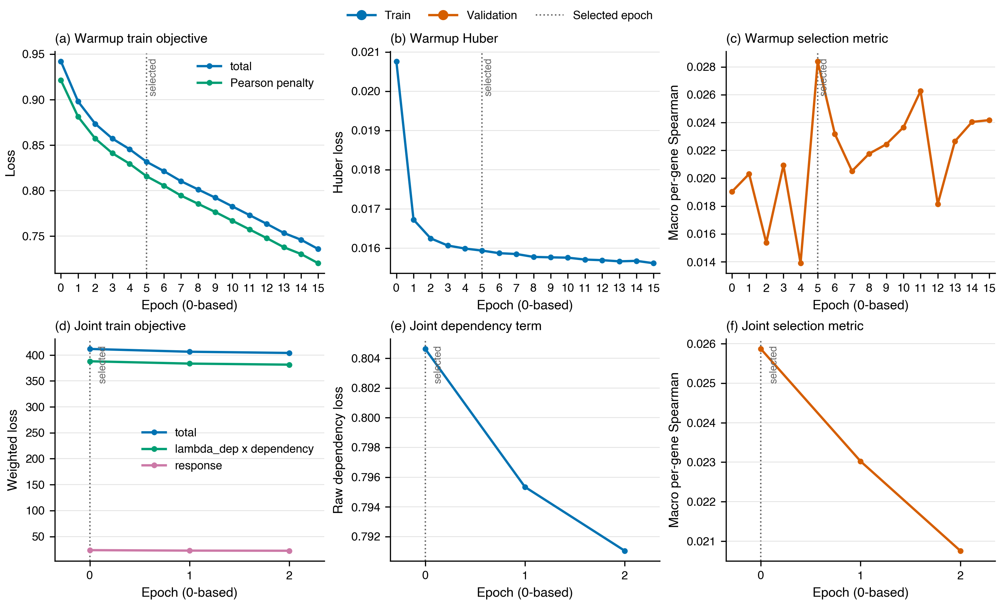

# Exp13 Formal Stage 2 GeneEffect Residual Benchmark

Historical staged protocol, retired on 2026-09-06. The replacement
joint training design (`docs/specs/2026-09-06-modular-joint-training-design.md`, removed; `git show 1694f5c:<path>`)
has no scientific run yet; the results below belong to the original staged run.

## What was tested

The fixed split contains 172 train, 27 validation, and 27 test cell lines over
17,787 GeneEffect genes. Stage 2 used 170 supervised train lines plus two registered
unlabelled train lines, one seed, and the full five-block model. The comparison set
is the registered residual ladder: context-PCA ridge, nearest-line, copy-prior, and
gene-mean.

## Method and provenance

- Run: `stage2_full_finalize_resume3_20260901T145000Z`, recovered for finalization
  from `stage2_full_metricfix_20260831T133606Z`.
- Training commit: `f8950c1169466234b286458705ac6da2b784a933`; final verifier:
  `f5376e2d7390c14cedb76b437c2529198ab4e3c3`.
- Hardware: 2 x H20, 2 DDP ranks, BF16.
- Selection: warmup epoch 5, then joint epoch 0, by validation macro per-gene
  Spearman. The finalization recomputation was 0.025902 versus 0.025867 in the
  selected training row, a 0.000034 difference within the registered BF16 rank-noise
  tolerance.

Historical Stage 1 training-data/code lineage remains incomplete. Tahoe-100M pretraining exposure also remains a
scope qualifier.

## Learning curves



Warmup training loss decreases monotonically through epoch 15, but validation is
noisy and peaks at epoch 5 (0.028389). During joint tuning, the total, response, and
dependency losses continue to decrease, while validation Spearman decreases from
0.025867 at epoch 0 to 0.020758 at epoch 2.

## Result

The held-out test result is a **negative point estimate**: the selected end-to-end model is below both registered
context-conditioned baselines on both reported rank metrics.

| Method | Test macro per-gene Spearman | 95% CI | Test macro per-line Spearman | 95% CI |
| --- | ---: | ---: | ---: | ---: |
| End-to-end full | 0.022472 | not emitted | 0.021720 | not emitted |
| Context-PCA ridge | **0.085132** | [0.082183, 0.088122] | **0.099327** | [0.071360, 0.127331] |
| Nearest-line | 0.046196 | [0.043214, 0.049070] | 0.057667 | [0.032391, 0.084318] |
| Copy-prior | undefined | constant across lines | 0.005736 | [-0.012518, 0.024908] |
| Gene-mean | undefined | constant residual | undefined | constant residual |

The end-to-end point estimate trails context-PCA ridge by 0.062660 per gene and
0.077607 per line, and trails nearest-line by 0.023725 per gene and 0.035946 per
line. Twenty of 27 test lines have positive within-line Spearman, but the macro
effect is small. Test is close to validation: -0.003430 per gene and +0.000069 per
line. The 27 model-specific values are in
the locally retained `e2e_test_per_line.csv` (not tracked in Git).

No paired end-to-end-versus-baseline bootstrap interval was emitted, and only one
seed was run: a negative point estimate, not a claim of statistical significance or multi-seed stability. The Stage 1
response before/after records are not comparable because the historical input lineage is incomplete; no response
delta is reported. This does not support a positive context-prediction claim; GeneEffect is single-gene dependency, so
this result is not synthetic-lethality evidence, does not test unseen genes, and does not substitute for
`context_screen_v2`.

## Reproduction

The locally retained telemetry and metric extracts are `learning_curves.csv`,
`test_results.csv` and `e2e_test_per_line.csv`; these CSV files are not tracked in
Git. With those extracts available, rebuild the figure with:

```bash
uv run python results/exp13_stage2_full/plot_learning_curves.py
```

The source run artifacts are `warmup_train_log.csv`, `joint_train_log.csv`,
`geneeffect_residual_metrics.json`, `checkpoint_selection.json`, `run_manifest.json`,
and `complete.json` in the formal H20 run directory.
